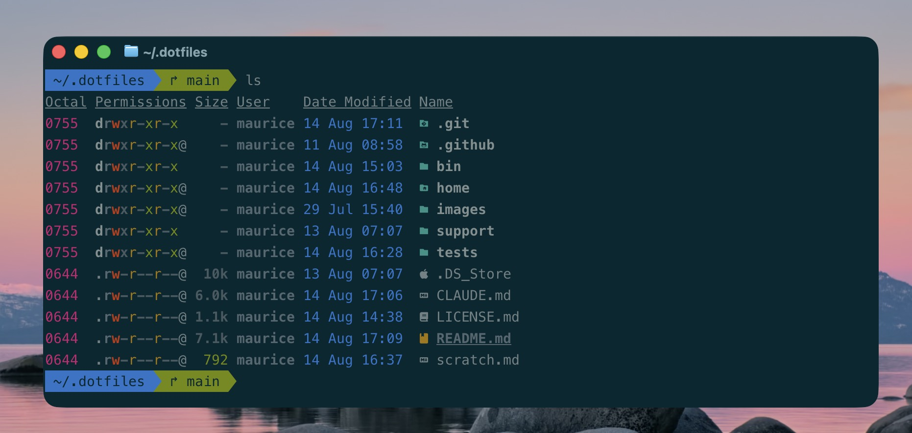

# My Dotfiles

[](https://github.com/moessimple/dotfiles/actions/workflows/tests.yml)



Opinionated dotfiles for Laravel and PHP development on macOS, built around my own workflow and meant to be forked
and adapted. One script sets up a fresh Mac, one keeps it up to date, and one reapplies the configuration.

## What's Included

- Laravel Herd, MySQL, Mailpit, and development applications
- Oh My Zsh, modern command-line tools, shell aliases, functions, paths, exports, Git configuration, and Git helpers
- Claude Code settings, agents, hooks, rules, skills, plugins, and MCP servers, kept under version control, with Addy
  Osmani's [agent-skills](https://skills.addy.ie) workflow and an automatic quality gate (Pint, PHPStan, Rector,
  Pest/PHPUnit)
- Global instructions and skills shared between Claude Code and Codex
- Global Composer and npm tools, and the Python packages the PDF skill needs
- Ollama with local models listed in [`support/setup/packages/ollama-models.sh`](support/setup/packages/ollama-models.sh)
- [tinkerbench](https://github.com/moessimple/tinkerbench), installed at `~/Code/tinkerbench`
- Ghostty configuration and macOS preferences

The complete list of Homebrew formulae, applications, fonts, Quick Look plugins, and Mac App Store apps is in
[`support/config/Brewfile`](support/config/Brewfile).

## Before You Start

> [!WARNING]
> The installer replaces existing files with symlinks and does not back them up. It also clears five Claude Code
> directories under `~/.claude/` (`agents`, `commands`, `hooks`, `rules`, `skills`) before linking them, and so does
> `bin/reconfigure.sh`, including when called by `bin/update.sh`. Review
> [`support/setup/clean-state.sh`](support/setup/clean-state.sh) and save anything you
> need there first.

The macOS setup enables FileVault and the application firewall, disables hibernation on Macs without a battery,
changes Finder and Dock behavior, applies German regional settings, and configures several bundled applications.
Review [`bin/macos-defaults.sh`](bin/macos-defaults.sh) if you do not want those choices.

If you fork this repository, adjust the personal defaults listed under [Make It Your Own](#make-it-your-own) first.

## Setting Up Your Mac

1. Update macOS via System Settings → General → Software Update.
2. Install the Xcode Command Line Tools if Git is not available yet:

   ```zsh
   xcode-select --install
   ```

3. Sign in to the App Store with your Apple ID. The Brewfile's Mac App Store apps are installed through `mas`, which
   can only install apps your Apple ID already owns.
4. Create a GitHub SSH key, unless you already have one for GitHub:

   ```zsh
   curl -fsSL https://raw.githubusercontent.com/moessimple/dotfiles/HEAD/bin/setup-ssh.sh | bash -s -- "your@github-email.com"
   ```

   [`bin/setup-ssh.sh`](bin/setup-ssh.sh) asks for a passphrase, adds the key to the SSH agent and macOS Keychain,
   copies the public key, and refuses to overwrite existing keys. Add the copied key at
   [github.com/settings/keys](https://github.com/settings/keys).
5. Clone this repository, or your fork, to `~/.dotfiles`, the path the scripts expect, and run the installer:

   ```zsh
   git clone git@github.com:moessimple/dotfiles.git ~/.dotfiles
   cd ~/.dotfiles && bin/install.sh
   ```

   The installer asks whether the machine is private or for work ([Machine Profile](#machine-profile)), for this
   machine's Git email ([Git Identity](#git-identity)), and for your administrator password. On a fresh Mac it waits
   until you complete Herd's onboarding in the Herd app. Before the macOS preferences, it asks you to close System
   Settings and confirm.
6. Restart your Mac.
7. Authenticate GitHub CLI, and choose SSH when `gh` asks for the Git protocol:

   ```zsh
   gh auth login -s user:email -w
   gh auth status
   ```

8. Put machine-specific settings and secrets in `~/.extra` ([Make It Your Own](#make-it-your-own)).

## Daily Usage

A selection of the commands I use most. The full list lives in [`home/.aliases`](home/.aliases),
[`home/.functions`](home/.functions), and [`support/git/`](support/git/). The Git helpers and most functions that take
arguments print their usage with `--help`.

### PHP and Testing

- `p` runs Pest or PHPUnit, `pp` runs the suite in parallel, and `pf <filter>` runs matching tests.
- `pc` runs the tests with code coverage.
- `puff <filter>` reruns a test until it fails, to reproduce a flaky test.
- `quality [full]` runs the quality gate by hand; `quality status` shows the last recorded run.

### Git and GitHub

- `commit [message]` stages and commits everything. Without a message, Claude writes one, falling back to Codex and
  then an interactive prompt.
- `switch <branch>` switches or creates a branch and asks whether uncommitted changes come along or stay behind.
- `review [base]` and `compare [base]` browse the branch's changes against a base branch with fzf.
- `search <term>` finds the commits that added or removed a string.
- `sync` resets long-lived branches to an `upstream` remote and force-pushes them to `origin`.
- `nah` aborts an in-progress Git operation, discards local changes, and removes untracked files.

`sync` and `nah` are destructive. Use them only when that is what you want.

### Databases and Tools

- `db <refresh|create|drop|list> [name]` manages local MySQL databases.
- `mf` / `mfa` fresh-migrates the current project's database, or all of its databases (main, test, and parallel test
  shards).
- `opendb` opens the current project's database in a GUI client, using credentials from its `.env`.
- `code [path]` opens VS Code, in the current directory when no path is given.
- `https://tinkerbench.test` runs PHP snippets against Herd-linked projects.

### Skills

Call a skill in Claude Code with `/<name>`, for example `/review`. Codex can use the same skills as `$<name>`.

- `debug` finds and fixes the root cause of a bug through a reproduce-first diagnosis loop.
- `review` reviews a pull request or the local changes and reports the verdict without changing files or posting to
  GitHub. The `review` shell command only browses the changes.
- `pr` turns the current branch into a pull request with a description of the problem, outcome, and evidence, and
  waits for approval before creating or updating it.
- `quality` runs the `quality` command for the [quality gate](home/.claude/hooks/README.md) and reports only checks
  that actually ran.

The other skills, including third-party ones, live in [`home/.claude/skills/`](home/.claude/skills/).

## Keeping It Up to Date

Use these aliases, or run the linked scripts directly:

| Command | What it does |
| --- | --- |
| [update](bin/update.sh) | Pull the repository, update managed packages, then run `reconfigure`. |
| [reconfigure](bin/reconfigure.sh) | Reapply symlinks, Codex skill links, services, and Herd/tinkerbench setup without package updates. |
| [macos-defaults](bin/macos-defaults.sh) | Apply macOS preferences separately. |

`update` removes undeclared Homebrew entries and Mac App Store apps, global Composer and npm packages,
user-installed Python packages, Ollama models, Claude Code skills and plugins, and user-level MCP servers without
asking. Project dependencies and project-level Claude Code integrations are not affected.

Edits to already-linked configuration files take effect directly. Run `reconfigure` after changing symlink
declarations or setup scripts if you do not need package updates.

[`macos-defaults`](bin/macos-defaults.sh) asks for confirmation and administrator access before applying
macOS preferences and quits affected applications, including Terminal. [`bin/install.sh`](bin/install.sh) also applies
these settings during initial setup.

## Make It Your Own

Use `~/.extra` for machine-specific environment variables, secrets, aliases, or other shell configuration that should
not be committed. Open it with the `extra` alias. Changes intended for every machine belong in this repository and
reach the other machines through Git.

If you fork this repository, adjust these personal defaults before installing:

- Git name in [`home/.gitconfig`](home/.gitconfig)
- Mac App Store apps (`mas` entries) in [`support/config/Brewfile`](support/config/Brewfile)
- Absolute working directory in [`home/.config/ghostty/config`](home/.config/ghostty/config)
- Locale and time zone in [`bin/macos-defaults.sh`](bin/macos-defaults.sh), if they
  don't match yours
- Absolute paths to my home directory in the lines Herd added to [`home/.zshrc`](home/.zshrc) and Docker Desktop
  added to [`home/.zprofile`](home/.zprofile)

## How It Works

Files under [`home/`](home/) mirror their locations below `$HOME`. For example, `home/.zshrc` is linked to
`~/.zshrc`, and `home/.claude/skills` is linked to `~/.claude/skills`. Editing either path changes the file stored in
this repository. The one exception is [`home/.claude/AGENTS.md`](home/.claude/AGENTS.md), described under
[Claude Code and Codex](#claude-code-and-codex).

### Machine Profile

[`bin/install.sh`](bin/install.sh) saves the profile as `private` or `work` in `~/.config/dotfiles/profile`.
[`support/setup/machine-profile.sh`](support/setup/machine-profile.sh) reads and validates it for install,
reconfigure, and update. Later installs reuse it. Reconfigure and update never prompt and default to private without
a saved profile. To change the profile, remove `~/.config/dotfiles/profile` and run `bin/install.sh` again, entering
the email for the new profile.

The work profile excludes AusweisApp, Discord, OneCast, and WhatsApp from
[`support/config/Brewfile`](support/config/Brewfile). Install and update use the same list, so update also removes
these apps from a work machine. System setup and all other packages are the same for both profiles.

### Git Identity

Your Git name is set in [`home/.gitconfig`](home/.gitconfig). The email differs per machine and lives in the untracked
`~/.gitconfig-local`, which `home/.gitconfig` includes last. On a private machine, `bin/install.sh` offers your
existing global email as a default, which you can accept with Enter or replace. Later installs ask again only if the
local email is missing or blank. Existing local settings are preserved.

`home/.gitconfig` has no fallback email and sets `user.useConfigOnly = true`, so Git refuses to commit until an
email is configured. If a machine has no local email yet, run `bin/install.sh` again or save it directly:
`git config --file ~/.gitconfig-local user.email "YOUR_EMAIL"`. Repository settings and Git environment variables
can still set the identity for individual commits.

### Release Cooldown

Composer and npm skip releases younger than 3 days. The setup sets this in their user-level configuration
([`support/setup/packages/composer-packages.sh`](support/setup/packages/composer-packages.sh),
[`support/setup/packages/npm-packages.sh`](support/setup/packages/npm-packages.sh)), so it also applies to every
project without its own setting.

Claude Code plugins and skills get the same 3-day cooldown
([`support/setup/claude/update-cooldown.sh`](support/setup/claude/update-cooldown.sh)). Git does not record a
reliable publish date, so the cooldown counts from the first update that sees a new upstream version: a skill's
folder, or a plugin's folder and marketplace entry. That version is installed once the update has seen it unchanged
for 3 days, so a plugin or skill that changes more often waits until it rests. Plugins from the same marketplace are
updated together once all of them have passed the cooldown, because refreshing a marketplace changes the
configuration of every plugin it defines. First sightings are recorded in
`${XDG_CONFIG_HOME:-~/.config}/claude-update-cooldown/first-seen`, so on a new machine every cooldown starts with the
first update.

## Claude Code and Codex

Claude Code and Codex share the same global instructions: [`home/.claude/AGENTS.md`](home/.claude/AGENTS.md) is
linked as `~/.claude/CLAUDE.md` and as `~/.codex/AGENTS.md`.

Skills that also work in Codex keep their source under `home/.claude/skills/` or Claude Code's installed plugin cache
and are linked individually into `~/.agents/skills/`, Codex's documented user skill directory. Only Claude Code
installs and updates them. The explicit allowlists in
[`support/setup/codex/codex-skills.sh`](support/setup/codex/codex-skills.sh) prevent Claude-specific skills and
duplicates of Codex's built-in skills from being shared accidentally.

Third-party skills are managed in
[`support/setup/claude/claude-skills.sh`](support/setup/claude/claude-skills.sh), while plugins and user-level MCP
servers are managed in [`support/setup/claude/claude-plugins.sh`](support/setup/claude/claude-plugins.sh). Run
`bin/update.sh` after changing either file. A new plugin marketplace also needs an entry with `"autoUpdate": false`
under `extraKnownMarketplaces` in [`home/.claude/settings.json`](home/.claude/settings.json), so that Claude Code
does not update its plugins on its own, outside `bin/update.sh`. `claude plugin marketplace add` removes that
setting, so `claude-plugins.sh` sets it again after adding a marketplace.

## Tests

Run the repository's Bats tests from the root:

```zsh
bin/test.sh
```

The suite covers the Claude Code quality hooks, scripts bundled with local skills, selected shell functions and
aliases, the Git helpers, and the update and setup scripts.

## Further Documentation

- [Quality Gate Hooks](home/.claude/hooks/README.md)
- [Repository Architecture](AGENTS.md), for working on this repository with Claude Code or Codex

## Credits

Inspired by [Freek Van der Herten's dotfiles](https://github.com/freekmurze/dotfiles) and
[Dries Vints's dotfiles](https://github.com/driesvints/dotfiles), adapted for my own Laravel, Herd, and Claude Code
workflow.

## License

MIT. See [`LICENSE.md`](LICENSE.md).
